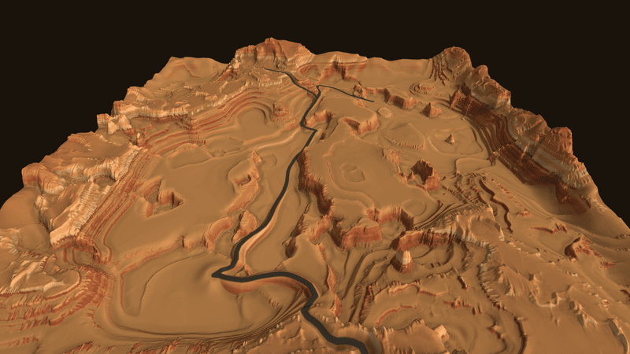
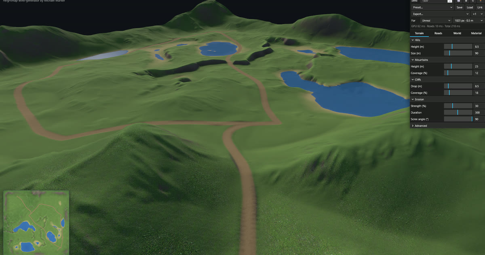

# Heightmap Level Generator

**Free procedural terrain and heightmap generator for Unreal Engine, Unity and Godot, running in your browser.
No install, no account.**

**▶ Try it: https://m-w-marker.github.io/heightmap-level-generator/** (needs WebGPU, e.g. desktop Chrome or Edge)



## What it does

- **Terrain on the GPU**, live while you drag sliders: hills, mountains, cliffs, rock terraces, erosion, rivers and lakes, 256–1280 m at 0.5 m per pixel
- **Road network** with towns, following the terrain, grade-limited, never under water
- **Four biomes**: temperate, steppe, desert, snow world, with textured 3D preview and colored rock bands (try the *Badlands* preset)
- **Walk through it** in first person, compare seeds side by side, share a map as a link



## Export

For **Unreal, Unity, Godot (Terrain3D) or three.js**, with engine-ready sizes and the import values in the metadata:

- 16-bit heightmap (PNG / `.r16`), splatmap, color map
- Masks: road, town, water, water level, slope, normals, curvature, flow
- Layout JSON (towns, roads, rivers, lakes) for PCG, Houdini or your own scripts
- 3D mesh as glTF `.glb`

Formats and parameters in detail: [docs/reference.md](docs/reference.md)

## Run locally

```bash
cd app
npm install
npm run dev
```

Open http://localhost:5173 (on Windows, `start.bat` does both). Built with WebGPU, WGSL, three.js and Vite.

## License

MIT, see [LICENSE](LICENSE). Everything you export is yours, also in commercial games. Textures are CC0.
